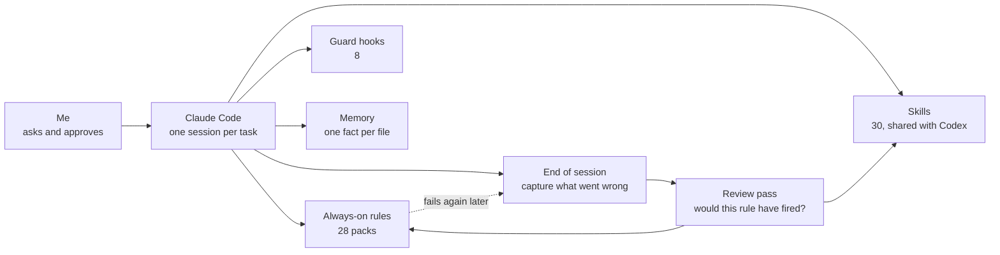

# Justin Choi

Software developer in Canada.

I work with Claude Code, one session per task, and I treat it like a new team member I'm training. We work through a problem together once and settle the pattern. Then I write the pattern down as a rule or a skill, so the next session handles that situation on its own and I only read the result and the report.

I also track Chinese and Japanese AI news and test the tools myself. I write about it on [Medium](https://medium.com/@justinmchoi) and [X](https://x.com/justinmchoi_ai).

## How I Build

**Who decides what.** These defaults are written into my rule packs. The agent follows them as instructions. Only Claude Code's permission check and the hooks below can actually stop a command.

- **The agent just does it:** read, search, edit and run tests.
- **It asks me first:** a commit, anything other people will see (a push, a pull request, a comment) and anything hard to undo.
- **When a security check blocks a change to a secret or a permission:** it stops and hands me the exact command. It doesn't look for another way around.

I publish my Medium and X posts by hand.

Two exceptions are written down. The review pass that maintains my toolkit may push to the toolkit's main branch after its checks pass. And I'm trying out an autonomous mode for my own projects. I turn it on for one session. The agent then commits and pushes to my repos without asking, but still asks before anything irreversible. When it hands back, it lists every action it took and how to undo each one.

**How it learns.** When I have to correct the agent, the session ends with a capture pass that writes the lesson down as a candidate. A later review pass checks each candidate against the rules already in place. Before it promotes one, it asks a single question: at the moment of the mistake, would this rule have been loaded? If a shipped rule fails again later, the lesson goes back into the loop.

**Rules get measured.** For example, I probed how Claude Code loads rules that are tied to file types. Each one loads once per context window, on the first matching file read (seven probes). So every rule set that matters also ships a short always-on version.

**Hooks for repeat mistakes.** A few mistakes kept coming back even with a written rule, so a hook now stops them: a shell edit that silently drops a backslash escape, a path that Git Bash rewrites on Windows, and a session that ends with unsaved files in a scratch folder that gets deleted with it.

## What I'm working on

- **AI Content Radar** (private): a weekly catch-up on the whole AI field from free public sources in English, Chinese and Japanese. I look for what one language community knows and another doesn't yet, then build small demos and write posts.
- **My agent toolkit** (private): the rules, skills and hooks above. The same skills install into Claude Code and Codex.
- **[ai-automation-recipes](https://github.com/justinmchoi/ai-automation-recipes):** redacted recipes for scheduled assistant automations.

The older public repos here are mostly coursework and learning projects from 2019 to 2023.
